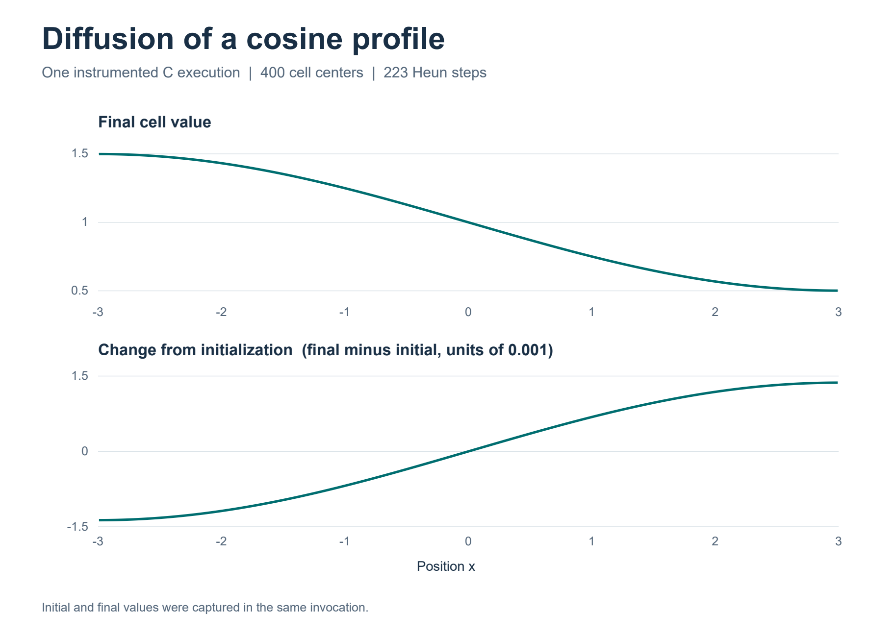
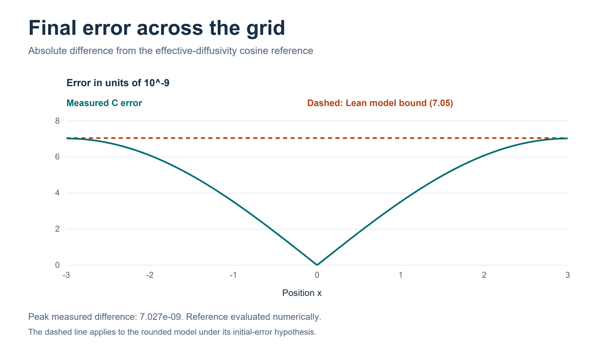
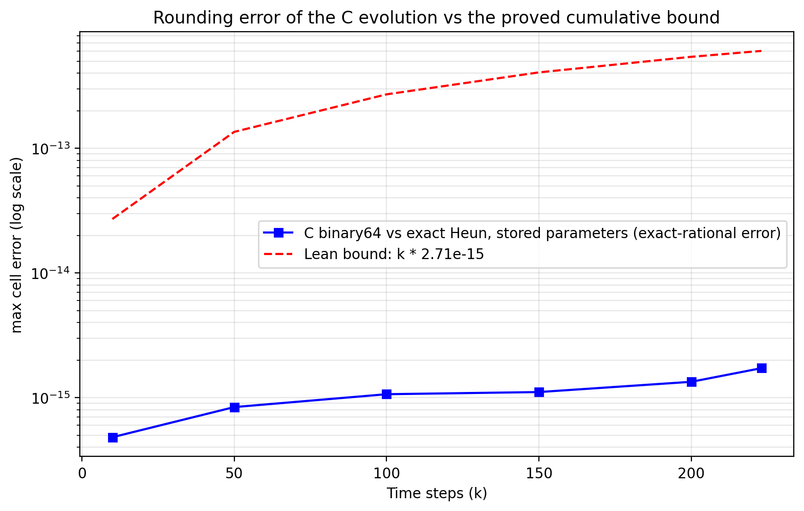

# FluxWitness: conditional verification of a C heat solver

FluxWitness collects Lean 4 proofs, C and Frama-C/WP evidence, numeric experiments, and independently stated trust conditions for a one-dimensional heat-equation benchmark.

**Frozen RC2 result (2026-11-08).** For the rounded 400-cell model with 223 stored-timestep Heun updates, the pointwise final error against the effective-diffusivity cosine reference is bounded by **7.05 × 10⁻⁹**, provided the initial pointwise error is at most **2.4854 × 10⁻¹⁶**. The reference is evaluated at 223 times the stored timestep. This is **not** an unconditional theorem about arbitrary compiled executables.

An exact-rational checker certified the initial-error premise for 400 initial values from one instrumented C run. That run exhibited a peak final difference of about **7.027 × 10⁻⁹** from the numerically evaluated cosine reference. A separate comparison of C arithmetic against exact-real Heun arithmetic found **1.7243 × 10⁻¹⁵** maximum discrepancy after 223 steps, against the rounded model's accumulated budget **6.0433 × 10⁻¹³**. Measurements and formal claims have different scopes.

## Figures

## Project contents

| Path | Content |
|---|---|
| `rc2/lean/` | Frozen RC2 Lean sources and six-declaration audit module |
| `rc2/c/` | Shipped C heat solver source |
| `rc2/evidence/` | Recorded execution, proof, and Frama-C/WP evidence |
| `rc2/README.md` | Detailed RC2 reproduction and trust statements |
| `figures/` | Three publication figures and vector PDFs where available |
| `publication-source/` | Figure generation script and source publication materials |
| `supplements/rounding/` | Arithmetic-comparison harness, data, and figure |
| `supplements/wider-initialization/` | Post-RC2 wider initial-error theorem and certificates |
| `supplements/nominal-reference/` | Post-RC2 nominal-diffusivity reference results |
| `docs/` | Scope, evidence provenance, release checksums and audit notes |
| `release-assets/` | Public-distribution ZIPs, not byte-identical to the private original RC2 archive |

The **post-RC2** wider-premise theorem permits an initial error up to **10⁻¹⁵** while retaining the **7.05 × 10⁻⁹** model bound. Wider driver/reference theorems are separately recorded. The four tested glibc/musl builds satisfy the *original* RC2 initial-error premise. See [the post-RC2 results](docs/POST_RC2_RESULTS.md) for scope and limitations.

## Reproduce and review

Start with [RC2 reproduction instructions](rc2/README.md) and the [replay audit](docs/REPLAY_LOG_NOTE.md). On a fresh machine with Lean 4.35, Lake and pinned upstream dependencies, the proposed test is `lake build ReleaseAudit` from `rc2/lean/`. A fully clean upstream-dependency build has not yet been independently demonstrated. Historical local replay and Frama-C/WP evidence are archived, but the compiler, runtime, memory layout, initialization and cross-tool interpretation remain explicit trust boundaries.

## Integrity and distribution boundary

The original frozen RC2 ZIP is preserved **outside this public repository** with SHA-256:

`d55c547640122ca101adba48b4fccd4d70067c2978a2a4c96983a76e5079a1b0`

This repository is a **path-redacted public distribution**, not an identical byte-for-byte reproduction of the original archive. A few archived machine-path strings were replaced; no theorem statements or proof commands were rewritten. See [distribution provenance](docs/DISTRIBUTION_PROVENANCE.md) for the exact modified files. Each public-distribution ZIP has its own checksum and is distinct from the original frozen RC2 archive. No license or DOI is asserted here.
